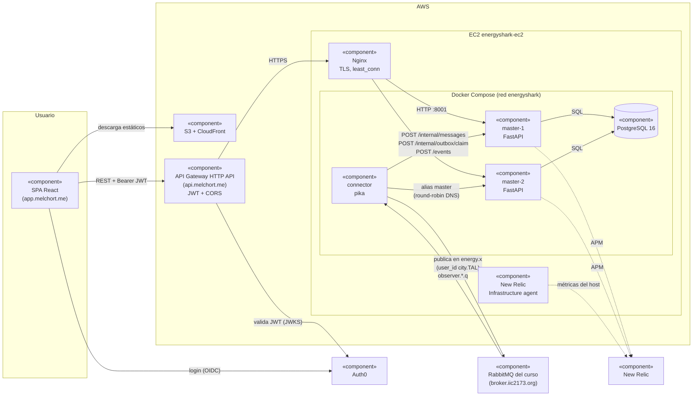

# Arquitectura

> RDOC03. Diagrama UML de componentes del nodo de Talca (`TAL`) y cómo correrlo en local. El
> detalle del flujo de mensajes está en [ciclo-negociacion.md](ciclo-negociacion.md), la
> infraestructura en [infraestructura.md](infraestructura.md) y el monitoreo en
> [monitoreo.md](monitoreo.md).

## Diagrama de componentes



### Componentes y sus interfaces

| Componente | Responsabilidad | Interfaz que provee | Interfaces que usa |
|---|---|---|---|
| SPA React | Vistas de RF01 (ciclos), RF02 (conectividad), RF04 (negociaciones) y RF05 (mensajes) | — | API pública por API Gateway; Auth0 |
| API Gateway | Única puerta de la SPA. Valida el JWT de Auth0 y pone los headers CORS (RNF01, RNF02) | `https://api.melchort.me` | Nginx |
| Nginx | TLS y balanceo `least_conn` entre las dos réplicas. Bloquea `/internal/` y responde 403 a las rutas de la E1 que no traen el header secreto que agrega el gateway | `https://melchort.me` | `master-1`, `master-2` |
| `master` (x2) | Decide: aplica mensajes al ledger, programa reportes, reintentos y peticiones, y sirve la API | API pública ([OpenAPI](https://github.com/G5ArquiSis/contratos/blob/main/openapi/openapi.yaml)) y `/internal/*` | PostgreSQL |
| `connector` | Transporta: valida el envelope, responde ACK/NACK, reenvía a `master` y publica la outbox | — | Broker AMQP; `/internal/*` y `/events` de `master` |
| PostgreSQL | Todo el estado: ledger, ciclos, negociaciones, outbox, distance-tables, message log e historial E0 | SQL | — |
| Broker del curso | Cola `city.TAL.q` (protocolo E1) y cola del observer (demand-set de la E0) | AMQP | — |
| New Relic | APM de `master` e infraestructura del host (G07, RNF05) | — | — |

### Decisiones que se ven en el diagrama

- **`connector` y `master` son contenedores separados** ([ADR-0001](adr/0001-topologia-consumo.md)).
  Si el broker se cae, solo `connector` reintenta, y la API sigue respondiendo con lo que ya está
  en Postgres.
- **`master` no tiene reloj propio.** Cada 5 s, `connector` llama a `POST /internal/outbox/claim`.
  Esa llamada revisa los plazos vencidos (el reporte del ciclo, los reintentos y vencimientos de
  negociaciones, las peticiones de status-statement) y entrega lo que haya que publicar
  ([ADR-0003](adr/0003-timeouts-negociacion.md)).
- **Dos réplicas sobre la misma base.** El trabajo programado y el claim de la outbox usan
  `SELECT ... FOR UPDATE SKIP LOCKED`, así ninguna réplica toma lo que ya tomó la otra. El ledger
  es append-only, con índice único por `idpk` ([ADR-0002](adr/0002-persistencia-ledger.md)).
- **El broker es la fuente de verdad de lo pendiente.** Si `master` falla, `connector` hace
  `nack(requeue=True)` y no confirma a la central, así que no hay cola en memoria que se pierda
  en un reinicio.

## Correr en local

Requiere Docker Compose v2 y las credenciales del broker en `.env`.

```bash
cp .env.example .env                 # completar BROKER_* y, para la E1, CITY_BROKER_PASSWORD
docker compose up --build
docker compose ps                    # postgres, master-1, master-2 y connector (healthy)
curl -i http://127.0.0.1:8001/health # master-1; master-2 en 8002
curl -s http://127.0.0.1:8001/cycles
```

En local no hay API Gateway ni Nginx: se llega a `master` directo y sin JWT. Sin
`CITY_BROKER_PASSWORD`, `connector` solo consume la cola del observer. La sección "Probarlo sin
la central" de [ciclo-negociacion.md](ciclo-negociacion.md) muestra cómo simular mensajes de la
central con `curl`.

El frontend se corre aparte (`npm run dev` en el repo `frontend`) y apunta a
`https://api.melchort.me`. No puede llamar directo al backend local: el backend no pone headers
CORS (eso lo hace solo API Gateway), y el navegador bloquearía las respuestas de
`127.0.0.1:8001`.

## Contrato

- API pública: `contratos/openapi/openapi.yaml`, generado con
  `python scripts/exportar_openapi.py ../contratos/openapi/openapi.yaml` (desde `backend/`, con
  el venv activo). Hay que regenerarlo cada vez que cambie un router o un DTO.
- Mensajes AMQP: `contratos/schemas/*.schema.json`.
- `/internal/*`: [ciclo-negociacion.md](ciclo-negociacion.md).
